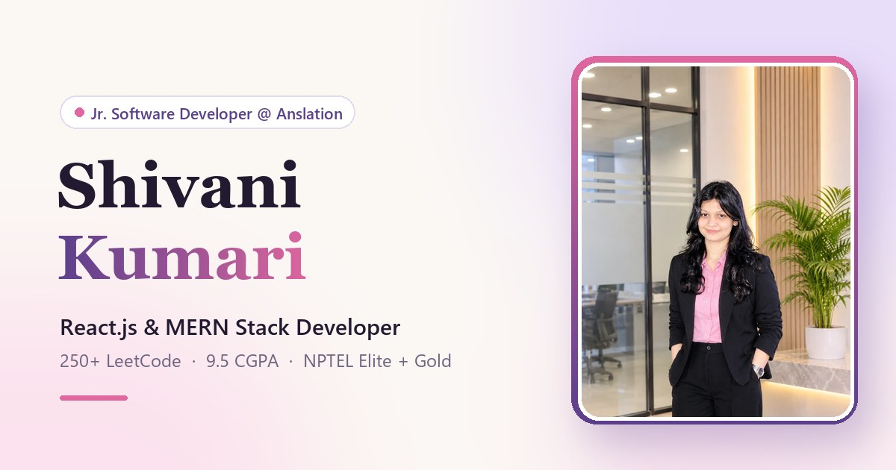

# Shivani Kumari — Portfolio

**Live:** https://shivani-kumari.vercel.app



Personal portfolio of **Shivani Kumari**, Jr. Software Developer at Anslation and React.js & MERN stack developer.

## Highlights

- Image-led project showcase with live screenshots of MediCare, Hotel Royal Stay and Cloth2Cash
- Intro preloader, custom cursor, smooth scrolling, mouse parallax and 3D tilt
- Scroll-driven reveals, a timeline that draws as you scroll, and marquee bands
- Fully responsive, and respects reduced-motion settings
- No build step: one `index.html` with inline CSS and JavaScript

## Tech

HTML5, CSS3, vanilla JavaScript, [Lenis](https://github.com/darkroomengineering/lenis) for smooth scrolling, Google Fonts (Fraunces and Inter). Hosted on Vercel.

## Run locally

Open `index.html` in a browser, or serve the folder:

```bash
python -m http.server 8000
```
